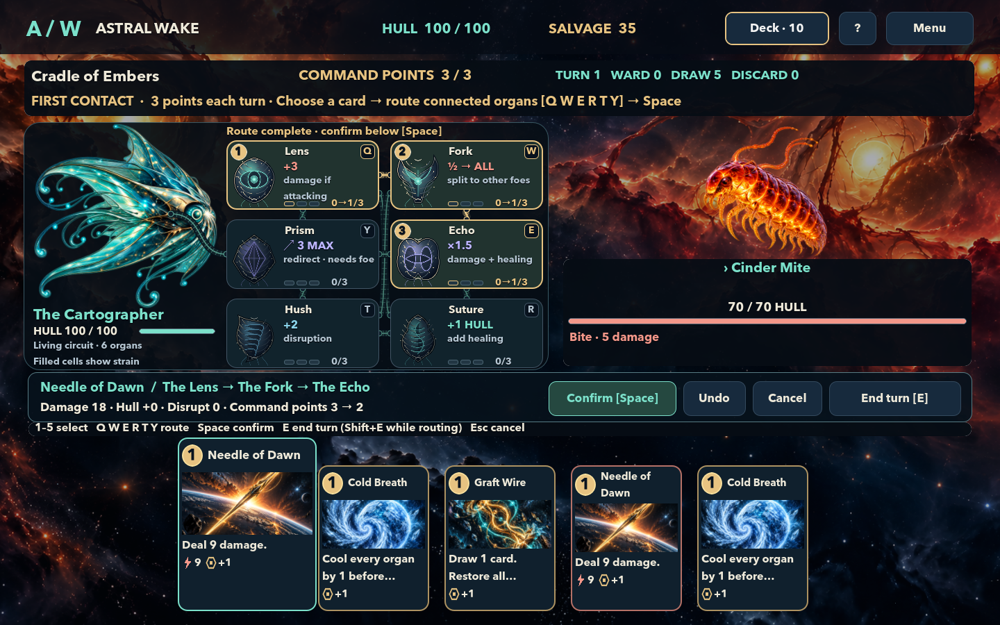
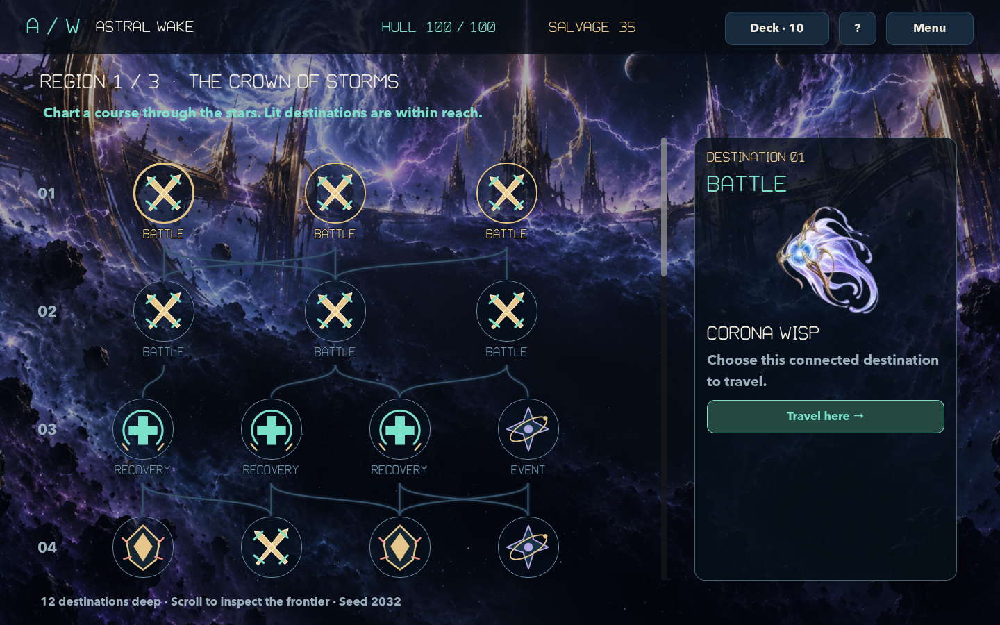
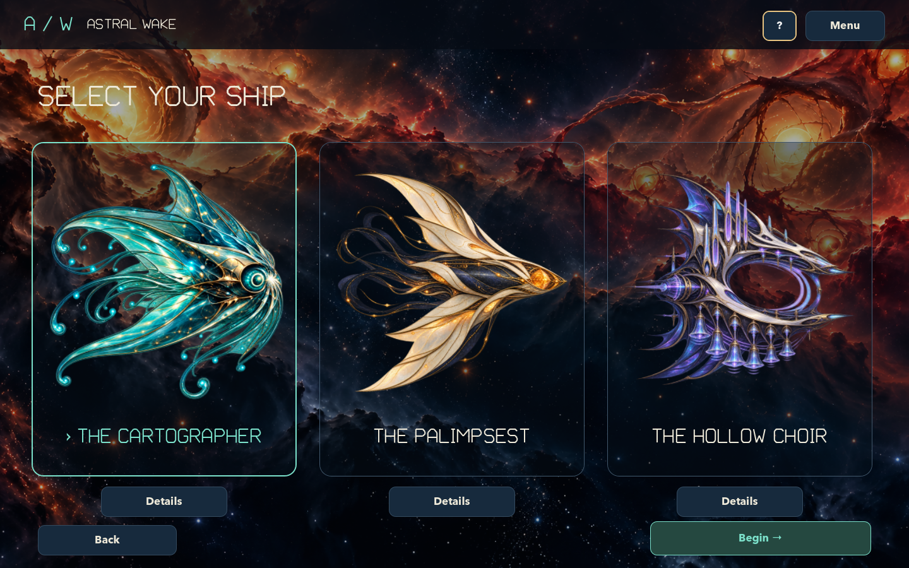

# Astral Wake

An offline deck-building roguelike about a sentient spacecraft finding its way through a strange cosmic frontier. Commands travel through a living circuit: their route changes their effects, and their strain shapes what you can do next.



*Every command follows a route. Organ order changes its effects; strain and command points shape your next move.*

| Choose your course | Choose your vessel |
| --- | --- |
| [](docs/gameplay.md) | [](docs/ships.md) |

## Learn to play

Start with the [gameplay guide](docs/gameplay.md), then explore the [ships and organs guide](docs/ships.md) for each vessel’s network, resource mechanics, starting deck, and example routes. The [documentation hub](docs/README.md) brings the guides together.

## Install on macOS

Requires macOS 11 or later. The universal app includes Apple Silicon and Intel binaries and its runtime; Godot does not need to be installed to play.

```sh
brew tap cdimartino/astral-wake https://github.com/cdimartino/astral-wake
brew install --cask cdimartino/astral-wake/astral-wake
```

The explicit repository URL lets this project also serve as its own [Homebrew tap](https://docs.brew.sh/Taps). Alternatively, download the ZIP from [GitHub Releases](https://github.com/cdimartino/astral-wake/releases), extract it, and move **Astral Wake.app** into Applications.

Release builds are ad-hoc signed and have not been notarized by Apple. If macOS blocks the first launch and you trust the release, try opening the app, then choose **System Settings → Privacy & Security → Open Anyway**. See [Apple's instructions](https://support.apple.com/102445).

## Play

Open **Astral Wake** from Applications. Developers can also open the local **dist/Astral Wake.app** build.

A skippable opening cinematic leads into the title screen; press any key or click to skip it. Combat and encounter choices use a fixed game stage, while the illustrated overmap scrolls vertically through branching routes that fork and merge. Ships move against regional backgrounds with six original looping soundtracks and action cues. Hover or focus a card to lift and enlarge its illustrated face, command cost, and effect icons. All enemies appear together, with names and hull bars below their artwork. Target markers, projectiles, impact flashes, floating points, healing, disruption, cooling and distinct enemy actions show what each command did. Reduced motion and volume controls are available in Settings.

Astral Wake Display is an original font reserved for large headings. Gameplay readouts and body text use Avenir Next, with semibold card and enemy names, brighter secondary text, and dark reading surfaces over illustrated backgrounds. The custom font is reproducible with `tools/make_font.py`. See the [UI legibility audit](docs/ui-legibility-audit.md) for findings and verification.

Choose **New expedition** and a vessel. Pick a connected map destination, then select a command, choose one to three connected organs, select an enemy, and confirm the preview. Rules commit immediately; a brief effect sequence shows each impact before the next action. Each turn gives you 3 command points: standard cards cost 1 and stronger cards cost 2. Organ strain also limits which routes remain available. End your turn to let enemies act, cool organs, and draw again. The opening encounter teaches the controls.

The living circuit sits beside a large ship portrait, above the command hand. Each illustrated organ shows its function and segmented strain meter. Teal borders mark available next steps; gold numbers and traveling signals show route order. Broken conduits show a coral cut, and hovering or focusing an organ highlights its connections. Filled cells are current strain, with gold outlines marking previewed changes. Full effects and conditions remain available in organ tooltips.

An [embedded-organ sample](docs/anatomy-sample.md) is available in combat and opens by default: organs sit inside a wide, translucent ship cutaway. Use **Console view / Anatomy view** above the vessel to compare layouts during the same battle. Anatomy uses strain arcs around specimens instead of the console's segmented cells.

| Input | Action |
| --- | --- |
| Mouse | Select a card, route organs, select a target, confirm |
| 1–5 | Select a hand card |
| Q W E R T Y | Route through the selected vessel’s six labeled organs |
| Space | Confirm the selected route |
| E | End turn when no card is selected |
| Shift+E | End turn at any time |
| Left / Right | Change target while routing |
| Escape | Skip an effect sequence, cancel selection, close overlay, or open pause menu |
| Tab / Shift+Tab, Enter | Focus and activate controls |

A route cannot repeat an organ or cross a severed connection. A saturated organ cannot accept a command. For the Cartographer, Lens then Fork then Echo is a useful first attacking route; Lens and Echo do not connect directly. Vent cools organs before the route adds strain. Disruption and redirection together prevent at most half of an attack. Prism redirects at most 3 damage and requires another living enemy; these defenses expire each enemy phase. Suture adds 1 repair to a routed command. Your hull, cards, and powerups persist through the expedition. Recovery sites and region transitions offer repairs.

### Three vessels

- **The Cartographer** starts with 100 hull and draws from the original 36-card pool. Lens, Fork, Echo, Suture, Hush and Prism transform commands in route order.
- **The Palimpsest** starts with 96 hull and has 18 distinct cards. Build up to 6 Trace, then spend it to recall damage, repair, redact or rewrite part of the previous command’s base payload. Its six organs form their own routing network.
- **The Hollow Choir** starts with 104 hull and has 18 distinct cards. Changing command kinds builds Resonance, up to 3; repeating a kind resets it before card and organ gains. Coordinate the phrase, then spend it on Crescendo, Cadence or Concert commands through a different six-organ network.

All three are available immediately, each with a ten-card starter deck and its own card rewards and shop pool. Every vessel has three command points, base capacity 3 and cooling 1. Concluded ordinary voyages unlock six optional Cartographer cards and three powerups; progression never increases a vessel’s starting stats. Entered-seed practice voyages never award durable progression or unlocks.

### Three stops, six possible areas

Each new expedition samples three different areas without replacement using its seed. Each visited area has twelve map layers, two to four destinations per ordinary layer, and one final boss. Enemy strength scales with the area’s position in the mission rather than its geographic identity.

### Replay a seed

New expeditions receive a **six-character code using A–Z and 0–9**. Leave the seed field blank for an ordinary voyage, or enter a code on the ship-selection screen to start reproducible practice. Victory and defeat both display the code and offer **Retry seed**, which restarts with the same vessel. Use the same vessel, game version and choices to reproduce maps, enemies, card order, rewards and shops. Lowercase entry is accepted and normalized to uppercase.

Entered-seed runs allow normal in-voyage upgrades but **no durable leveling, discovery-tier gains or unlocks**, including after defeat or abandonment. They still save/resume and appear as practice in run history. The code includes the original discovery pool, so a retry is unaffected by later profile progression. [Seeding engine and guarantees](docs/seeds.md).

| Possible area | Guardian |
| --- | --- |
| Cradle of Embers | The Unhatched Sun |
| The Choir of Wrecks | The Salvage Parliament |
| The Glass Beyond | The Witness Array |
| The Verdant Engine | The Root of All Suns |
| The Tidal Archive | The Drowned Catalogue |
| The Crown of Storms | The Crown Unbound |

Enemy intentions appear as icon-and-number badges. Hover or keyboard-focus a badge for a rich explanation of its action, targets, and defenses; attack numbers show damage after disruption and redirection, before shared ward absorption. Plasma, shards, sonic waves, memory trails and kinetic fire have distinct combat effects. Hull repairs stitch across the vessel, wards form hexagonal shells, and enemy phases signal each acting foe before cooling and command-point refill. The Parliament shares protection while attendants survive; the Witness punishes repeating the immediately previous route. New areas bring rebuilding root engines, gravity records and storms that can sever multiple links.

All 36 enemies have distinct repeating tactical profiles: armored and exposed phases, route weaknesses, interruptible support actions, drain, or overload attacks. Hover or focus an intent badge for its cycle and counter. Strain targets the busiest organs; cuts target your last route first, letting you anticipate and bait them. See the [enemy field guide](docs/enemies.md).

The release contains **72 command cards, 18 shared powerups, 24 regular enemy types, 6 elites, 6 bosses and 18 events**.

## Saves and settings

Progress saves after committed actions and completed choices. Continue resumes the current expedition, including its selected vessel, itinerary, combat meters, shuffled deck and pending rewards. New expeditions require confirmation before replacing active progress. The app preserves a previous save generation and attempts recovery if the primary is unreadable.

Default save folder: `~/Library/Application Support/Godot/app_userdata/Astral Wake/`.

Files: `save.json` and `save.backup.json`. Earlier saves retain the Cartographer and their original three-area itinerary without reshuffling the deck or map. Combat saves from the earlier cost-free prototype resume with zero points if a card had already been played that turn; End Turn starts the next turn with all 3 points. Settings include master volume plus separate music/cinematic, combat-effects, and interface volumes, fullscreen, and reduced motion. Audio sliders apply and save immediately; zero mutes the selected category. Existing profiles retain their master volume with category levels at 100%. Everything stays on this Mac. Test tools use isolated temporary save directories through `ASTRAL_SAVE_DIR`.

## Develop

Pinned engine: **Godot 4.7.2 stable**, standard GDScript build, Compatibility renderer. Download checksums are pinned to the official release asset digests.

```sh
bash tools/bootstrap.sh
.tools/Godot.app/Contents/MacOS/Godot --editor --path .
```

Run checks and export:

```sh
bash tools/check.sh
bash tools/export_macos.sh
bash tools/package_release.sh
```

Packaging creates `dist/Astral-Wake-0.1.0-macos.zip` from the exported app, cleans Finder metadata in a temporary copy, applies an ad-hoc signature, and verifies both architectures and the signature after ZIP extraction. Use its printed SHA-256 in `Casks/astral-wake.rb` before publishing the matching release.

The bootstrap downloads approximately 1.5GB of editor/export archives into ignored `.tools/`. Only the Mac template is extracted. On macOS, editor import/export needs permission to write Godot's normal user-data/editor settings folder; restricted automation sandboxes may require an approved native launch.

## Structure

- `scripts/game.gd`: deterministic action validation, previews/resolution, expedition, rewards and progression.
- `scripts/seed_engine.gd`: versioned gameplay RNG, independent persisted streams, six-character codes and legacy RNG compatibility.
- `scripts/save_store.gd`: versioned JSON, atomic replacement and validated-backup preservation.
- `scripts/main.gd`, `scripts/space_canvas.gd`, `scripts/intro_cinematic.gd`: native presentation, opening film, input and audio.
- `data/catalog.json`: authored content, stable IDs, balance values.
- `art/`: original backgrounds, vessel/enemy artwork, and 72 command illustrations; prompts and provenance live alongside the assets and in `art/PROMPTS.md`.
- `audio/`: original synthesized region music and effects; reproducible with `python3 tools/make_audio.py`. Rebuild the 22 combat cues separately with `python3 tools/make_combat_audio.py`; attack families have distinct launches and impacts, with overlapping voices and subtle pitch variation. Use `--cards-only` to rebuild the brief, dry paper draw/discard sounds.
- `tests/`: headless rules/regression checks, native scene smoke and deterministic full-run policy.
- `docs/`: gameplay guide, ship and organ reference, and reproducible native screenshots.

## Verification boundaries

Automated fresh-profile policies exercise complete expeditions and genuine defeat states. Tests cover all three vessels’ mechanics, randomized itineraries, map reachability, legal routes, previews, corrupted saves, legacy migration, backup recovery and duplicate rewards. The playthrough driver uses the same public actions as the UI; it is excluded from the exported app.

The 60–90 minute duration is a design target, not a measured human playtest result. Accelerated runs measure card/turn counts and cannot establish how long someone takes to learn or decide. Balance needs human playtesting. The universal binary includes Apple Silicon and Intel; only Apple Silicon is locally tested. Release archives are ad-hoc signed; Apple notarization and storefront integration are not included.

Godot and bundled dependency notices: `THIRD_PARTY_NOTICES.md`, `GODOT_LICENSE.txt`, `GODOT_COPYRIGHT.txt`.
