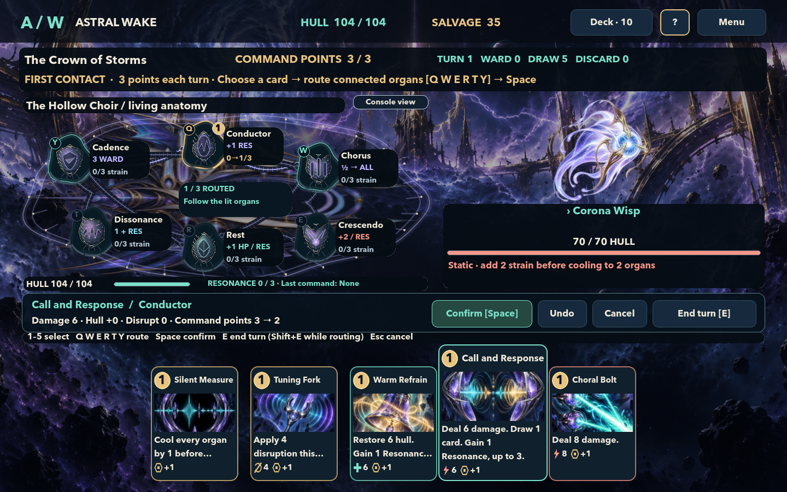

# Embedded-organ sample

Combat now opens in **Anatomy view**: an enlarged, translucent vessel with its six specimens nestled into an irregular internal network. Each organ has a living socket and short function readout rather than a rectangular tile. Curved, ribbed nerves follow the actual battle connections.

- Use **Console view** above the ship to compare with the previous layout. **Anatomy view** switches back. The selected card, route, target and battle state are preserved.
- Gold numbers show route order; illuminated sockets mark legal next steps.
- Arcs around each specimen show strain. Gold arc segments preview changes, and the numeric readout remains alongside the organ.
- Hover or focus an organ to show its function conditions in the central readout. Hover for its full tooltip.
- The six routing keys and combat rules are unchanged. The anatomy layout runs clockwise from Q at the top.

## Hollow Choir



[Previous console](screenshots/hollow_choir-combat.png)

## Other vessels

- [Cartographer sample](screenshots/cartographer-anatomy.png) · [previous console](screenshots/cartographer-combat.png)
- [Palimpsest sample](screenshots/palimpsest-anatomy.png) · [previous console](screenshots/palimpsest-combat.png)

The sample uses the existing vessel artwork expanded into a wide cutaway, with a procedural membrane and mineral ribs layered over it. The vessel texture stays visible through the membrane; specimen captions keep opaque backing for readability.

Reproduce these captures with:

```sh
.tools/Godot.app/Contents/MacOS/Godot --path . --script tools/capture_screenshots.gd -- --anatomy-sample
```
