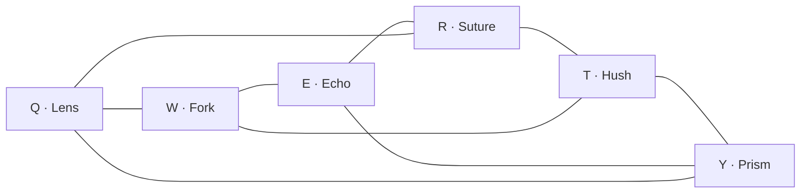
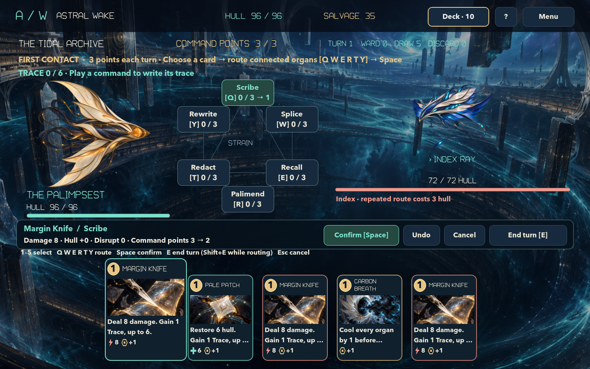
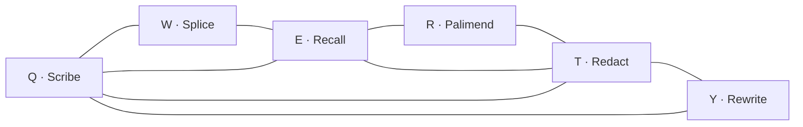
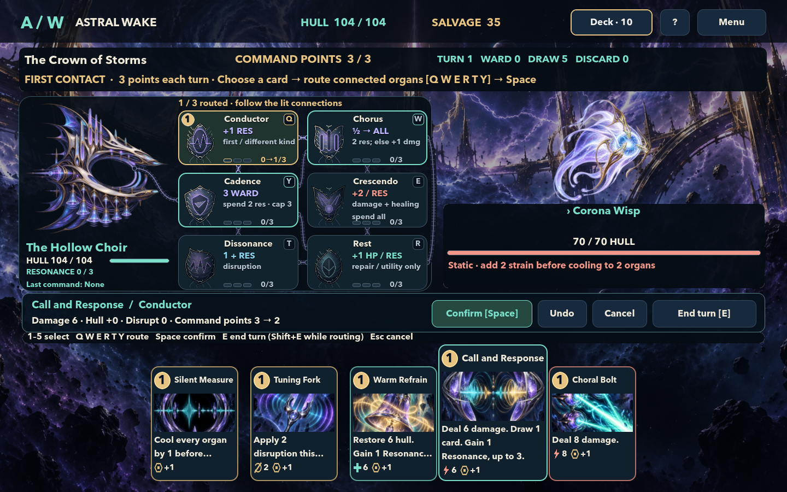
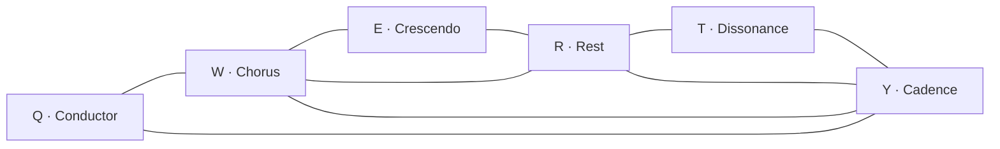

# Ships and organs

Production ship decks/upgrades are unchanged by the test-only
[branching evolution infrastructure](branching-evolutions.md). Authored branches
for the three ships are future content, not available in this slice.

Choose a vessel when you begin a new expedition. Each has its own six-organ network, ten-card starter deck and card pool. The Cartographer shapes damage and healing through order; the Palimpsest saves and spends Trace; the Hollow Choir builds a phrase by changing command kinds.

| Vessel | Starting hull | Card pool | Main decision |
| --- | ---: | ---: | --- |
| [The Cartographer](#the-cartographer) | 100 | 36 cards | Add, multiply and split in the right order |
| [The Palimpsest](#the-palimpsest) | 96 | 18 cards | Bank Trace or spend it now |
| [The Hollow Choir](#the-hollow-choir) | 104 | 18 cards | Alternate kinds and coordinate Resonance spending |

For combat controls, enemy intentions and the expedition map, see the [gameplay guide](gameplay.md).

## Rules every ship shares

- You start each turn with **3 command points**. Cards cost **1 or 2** points; drawing cards does not give more points. You can play at most three cards before ending the turn.
- Route each card through **one to three different organs**. You may start anywhere. Each step must follow an open connection; all connections work in both directions. The diagrams below show the starting networks. Linking cards can add a connection for the current battle, while enemies can temporarily sever connections.
- Every organ starts with **capacity 3**. Each routed organ normally gains **1 strain** per card. An organ already at capacity cannot enter a route, even if the selected card would cool it. Cooling cards remove strain from every organ before adding the new route's strain. After enemies act, every organ cools by **1**; powerups can improve capacity or cooling.
- **Organ order matters.** A later organ sees changes made by earlier ones. A split effect uses the command's final damage: the selected enemy takes full damage, and **each other living enemy** takes half, rounded down. It does not divide a fixed total among the enemies.
- Disruption affects only the selected enemy. Disruption and redirection together can prevent at most **half its attack, rounded down**, with disruption used first. Both expire during the next enemy phase, even if that enemy uses a non-attack intention. Ward absorbs the remaining incoming damage and expires at the end of that phase.
- Attack, repair and utility are **card kinds**. Adding healing to an attack or adding damage to a utility card does not change its kind.

The examples below use unupgraded cards, no powerups, open links and available strain capacity. Damage is before enemy protection and remaining-hull limits; healing cannot exceed your maximum hull. Always check the live preview for the current battle.

### Reading the living circuit

Your ship and its organs share one console directly above the hand, with a large vessel portrait beside two columns of specimens. Each specimen has a short function readout; hover for the complete effect and its conditions. The six keys run clockwise: **Q W** on the top row, **Y E** in the middle, and **T R** at the bottom.

- **Teal outline:** a legal next organ for the selected card. Hover or keyboard-focus an organ to illuminate its connections.
- **Gold number and signal:** a selected step and its direction through the route. Click a selected organ to undo it and all later steps.
- **Strain cells:** filled cells show current strain; gold outlines mark cells that will change. The adjacent numbers show current → projected strain and capacity. Full organs are marked **FULL**.
- **Coral cut:** a severed conduit. It cannot carry a command until restored.

The illustrations and conduit colors vary with the vessel. Reduced motion retains numbered steps, direction arrows and every state indicator without moving signals.

## The Cartographer

The Cartographer has **100 hull** and no extra combat meter. Its strength comes from arranging additions, multiplication and split damage. It has the largest card pool, with **36 commands**.

### Network

The six organs form a ring. Three cross-connections join Lens–Suture, Fork–Hush and Echo–Prism. **Lens and Echo have no direct starting connection.** The letters are their routing keys while a card is selected.

### Organs

| Key | Organ | Effect when reached |
| --- | --- | --- |
| Q | **The Lens** | If the command currently deals damage, add **3 damage**. It cannot create damage from zero. |
| W | **The Fork** | Enable split damage to every other living enemy. Their damage is **half the final command damage, rounded down**. |
| E | **The Echo** | Multiply current damage and healing separately by **1.5**, rounding each down. Disruption is unchanged. |
| R | **The Suture** | Add **1 healing**, including to a card that had none. |
| T | **The Hush** | Add **2 disruption** to the selected enemy for the coming enemy phase. |
| Y | **The Prism** | Give the selected enemy up to **3 redirection** for its next attack that phase. It needs another living enemy, does not stack beyond 3, and shares the half-attack defense limit with disruption. Redirected damage strikes another living enemy. |

### Starter deck

| Copies | Card | Kind | Cost | Base effect |
| ---: | --- | --- | ---: | --- |
| 3 | Needle of Dawn | Attack | 1 | 9 damage |
| 1 | Quiet Pulse | Attack | 1 | 7 damage; 1 disruption |
| 1 | Sun Splinter | Attack | 1 | 12 damage |
| 2 | Hull Stitch | Repair | 1 | Restore 7 hull |
| 2 | Cold Breath | Utility | 1 | Cool all organs by 1; draw 1 |
| 1 | Graft Wire | Utility | 1 | Draw 1; restore severed links and connect the first and last routed organs for this battle |

### Try these routes

**Build a stronger volley.** Needle of Dawn through **Lens → Fork → Echo** becomes `(9 + 3) × 1.5 = 18` damage to the target and **9 to each other enemy**. Reverse the same path to **Echo → Fork → Lens** and rounding happens earlier: `floor(9 × 1.5) + 3 = 16`, with **8** split damage.

**Multiply the repair after adding it.** Hull Stitch through **Suture → Echo** heals **12**: `(7 + 1) × 1.5`. **Echo → Suture** heals **11**: `floor(7 × 1.5) + 1`.

**Use the enemy intention to choose defense.** Prism has no benefit against a lone enemy. Against an enemy attacking for 9, disruption and redirection can prevent only **4** damage together. Adding more disruption after reaching that limit will not stop the remaining 5; ward can absorb damage after that calculation.

## The Palimpsest

The Palimpsest has **96 hull** and **18 cards**. Its **Trace** meter starts at **0**, caps at **6**, and persists between turns in the same battle. A new battle resets Trace and the remembered command.

### Network

The ring has an extra triangle joining **Scribe, Recall and Redact**. Those direct connections let you move quickly between gaining, spending and defending.

### Trace and memory order

1. Gain any Trace printed on the card, up to 6.
2. If the card has **Rewrite**, spend all current Trace **before routing**. If at least 1 was spent, add **2 damage per Trace**, plus half the previous command's base damage, healing and disruption, rounding each down.
3. Visit the selected organs in order. They can gain or spend the Trace remaining at that moment.
4. Remember this card's own base damage, healing and disruption for the next command.

The remembered base includes the card's upgrade bonuses. It excludes Trace bonuses, copied effects, organs and powerups, so rewritten damage cannot grow by copying its own previous amplification. Memory stores only the immediately previous played command, even across turns. A utility card with no base damage, healing or disruption replaces those remembered values with zero. Draw, cooling and links are never copied.

**A Rewrite card and the Rewrite organ have different costs.** The card spends all Trace before the route; the organ spends 2 Trace when reached. Scribe can replenish Trace between those two moments.

### Organs

| Key | Organ | Effect when reached |
| --- | --- | --- |
| Q | **Scribe** | Gain **2 Trace**, up to 6. |
| W | **Splice** | With **2 or more Trace**, enable half-strength split damage without spending Trace. Otherwise, add **2 damage** if the command currently deals damage. |
| E | **Recall** | If the command currently deals damage, spend **all Trace** and add **2 damage per point**. With no current damage, it neither spends Trace nor creates damage. |
| R | **Palimend** | Spend **1 Trace** to add **2 healing**. No effect at 0 Trace. |
| T | **Redact** | With Trace, spend **1** to add **3 disruption**; with none, add **1 disruption**. The usual defense limit applies. |
| Y | **Rewrite** | With at least **2 Trace**, spend 2 and add half the remembered base damage, healing and disruption, rounding each down. Below 2 Trace, do nothing. On the first command, memory is empty; the organ can still spend Trace without copying anything. |

### Starter deck

All ten starter cards cost **1 command point**.

| Copies | Card | Kind | Base effect |
| ---: | --- | --- | --- |
| 3 | Margin Knife | Attack | 8 damage; gain 1 Trace |
| 2 | Pale Patch | Repair | Restore 6 hull; gain 1 Trace |
| 1 | Carbon Breath | Utility | Cool all organs by 1; draw 1; gain 1 Trace |
| 1 | First Draft | Attack | 6 damage; gain 2 Trace |
| 1 | Ghost Line | Utility | Draw 2; restore severed links and connect route endpoints for this battle; gain 1 Trace |
| 1 | Revision Spike | Attack | 12 damage |
| 1 | Overwrite | Attack | 6 damage; Rewrite: spend all Trace for 2 damage per point and, if any was spent, half the previous base damage, healing and disruption |

### Try these routes

**Build, split, then cash out.** Starting at 0 Trace, Margin Knife through **Scribe → Splice → Recall** first gains its printed 1 Trace. Scribe raises that to 3; Splice enables split; Recall spends all 3 for 6 extra damage. The result is **14 damage to the target, 7 to each other enemy, and 0 Trace**.

Reverse that route to **Recall → Splice → Scribe**: Recall spends the card's 1 Trace, making 10 damage; Splice sees 0 Trace and adds 2 damage instead of splitting; Scribe finishes with 2 Trace. You deal **12 damage to one target and retain 2 Trace**. Choose whether this card should clear enemies or prepare the next command.

**Copy a strong base command.** From 0 Trace, play Revision Spike through **Scribe**: deal 12 damage, bank 2 Trace, and remember 12 base damage. Next play Overwrite through **Scribe**. Its card effect spends those 2 Trace before routing, giving `6 + 4 + 6 = 16` damage. Scribe then banks 2 new Trace. The next remembered base damage is **6**, not 16.

## The Hollow Choir

The Hollow Choir has **104 hull** and **18 cards**. Its **Resonance** starts at **0**, caps at **3**, and persists between turns. A new battle resets both Resonance and the previous command kind.

### Network

Its extra triangle joins **Chorus, Rest and Cadence**, giving non-attack commands a direct path between recovery, split preparation and ward.

### Resonance order

1. Compare this card's kind with the last played card. A **different kind gains 1 Resonance**; the **same kind resets Resonance to 0**. The first card has no automatic gain or reset.
2. Add any Resonance printed on the card, up to 3.
3. If the card has **Concert**, spend all current Resonance, adding **2 damage and 1 healing per point** before routing.
4. Visit the organs in order, then remember this card's kind.

Repeating a kind resets the meter **before** printed gains and organs. A repeated utility card can therefore still gain Resonance through its own effect or Rest. Conductor does not reward a repeated kind. These comparisons continue across turn boundaries; ending a turn does not start a new phrase.

### Organs

| Key | Organ | Effect when reached |
| --- | --- | --- |
| Q | **Conductor** | Gain **1 Resonance**, up to 3, if this is the battle's first command or its kind differs from the previous command. This is additional to the automatic different-kind gain. |
| W | **Chorus** | With **2 or more Resonance**, enable half-strength split damage without spending it. Otherwise add **1 damage** if the command currently deals damage. |
| E | **Crescendo** | Spend **all Resonance**. If the command currently deals damage, add **2 damage per point**; if it currently heals, add **2 healing per point**. A command already doing both receives both bonuses. It spends the meter even if neither effect is present. |
| R | **Rest** | For a **repair or utility** card, add **1 healing** and gain **1 Resonance**, up to 3. An attack receives neither, even if it has gained healing elsewhere. |
| T | **Dissonance** | Add **1 disruption plus current Resonance**, without spending it. The usual defense limit applies. |
| Y | **Cadence** | With at least **2 Resonance**, spend 2 to add up to **3 ward**, without raising your ward above 3. It still spends the Resonance if ward is already full. Existing ward above 3 is preserved. Below 2 Resonance, do nothing. |

Concert and Crescendo are separate spends. A Concert card empties the meter before organs act; later organs may build more Resonance for Crescendo or Cadence. Concert can add healing to an attack, while Crescendo only amplifies healing already present when it is reached.

### Starter deck

| Copies | Card | Kind | Cost | Base effect |
| ---: | --- | --- | ---: | --- |
| 3 | Choral Bolt | Attack | 1 | 8 damage |
| 2 | Warm Refrain | Repair | 1 | Restore 6 hull; gain 1 Resonance |
| 1 | Silent Measure | Utility | 1 | Cool all organs by 1; draw 1; gain 1 Resonance |
| 1 | Call and Response | Attack | 1 | 6 damage; draw 1; gain 1 Resonance |
| 1 | Tuning Fork | Utility | 1 | 4 disruption; gain 1 Resonance |
| 1 | Bright Canon | Attack | 2 | 12 damage; Concert: spend all Resonance for 2 damage and 1 healing per point |
| 1 | Hushed Chord | Utility | 1 | Cool all organs by 1; 6 disruption; gain 1 Resonance |

### Try these routes

**Prepare a phrase, then release it.** As the battle's first card, Warm Refrain through **Rest → Chorus → Conductor** gains its printed 1 Resonance, then another from Rest and another from Conductor. It heals **7** and ends at **3 Resonance**. Chorus enables split, but this command has no damage to split.

Next, Choral Bolt through **Chorus → Crescendo** changes from repair to attack. The automatic gain cannot exceed the cap of 3. Chorus enables split; Crescendo spends all 3 to add 6 damage. You deal **14 damage to the target and 7 to each other enemy**, ending at 0 Resonance. The two cards together cost 2 points.

**Take the Concert bonus before rebuilding.** With 3 Resonance and a previous utility card, Bright Canon through **Conductor → Chorus → Crescendo** spends the capped 3 on Concert first, becoming 18 damage and 3 healing. Conductor then gains 1 Resonance; Chorus sees only 1 and adds 1 damage instead of splitting; Crescendo spends that 1 to add 2 damage and 2 healing. The result is **21 damage, 5 healing and no split**, for 2 points. The preview makes that early Concert spend visible before you commit.

## Upgrades and powerups

Upgrading a card adds **3** to its positive base damage, **2** to its positive base healing, **1** to positive cooling and **1** to positive disruption. It does not change the command's cost, kind, printed Trace or Resonance, or number of cards drawn. If a card has none of those four base effects, its upgrade instead prevents strain on the **first routed organ**. For example, upgraded Ghost Line still draws 2 and gains 1 Trace, with that first-organ strain benefit.

Powerups can change these baseline calculations. In particular, **Echo Pearl** adds its damage bonus at Echo, Recall or Crescendo when the command is damaging, and **Forked Rib** adds damage to secondary split hits. The ship tables describe the organs without those bonuses; use the preview when combining a resource spend with your collected powerups.
