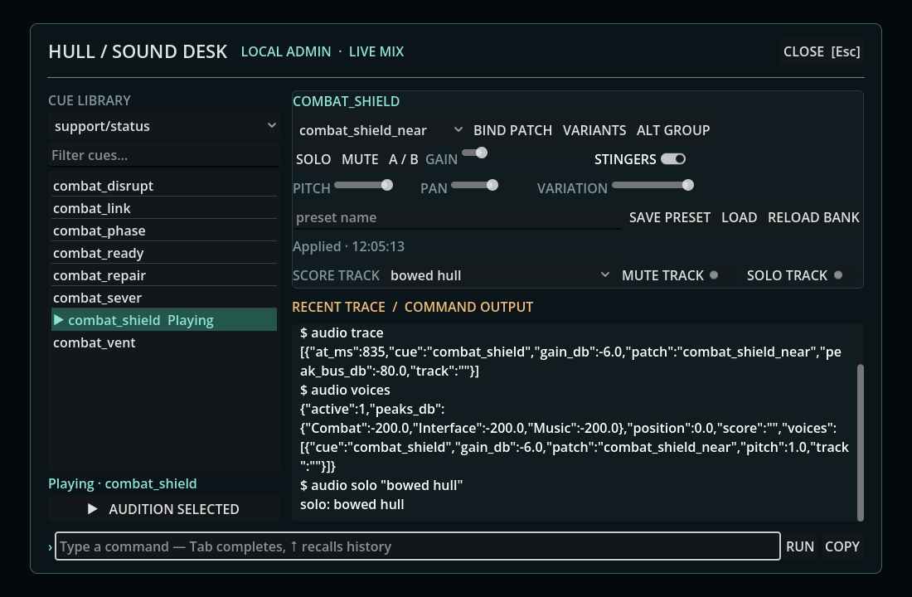

# Space heard through the hull

The opening plays once, then leaves a quiet breath under the title and ship selection. The star chart has its own sustained space ambience; rewards, shops, and recovery share a quieter cabin sound. In combat, cards and organs sound closer than the landscape, and the first committed route brings a quiet tension part into the regional score.

**Try it in the game:** open **Settings → Enter admin mode · Sound Desk**. This parks your expedition and opens a private copy. Hide the desk to play the copy, bring it back with the **Sound Desk** button or the configured shortcut (backtick by default), and use **Settings → Leave admin mode** to return. The shortcut is rebindable in Settings. Normal audio sliders still control music/cinematic, combat, and interface independently.

Look at **Playing** to identify a sound as you hear it. Matching rows light up together; brief cues leave a short afterglow. Your selection stays put, and the indicator also names sounds hidden by the current filter.

## Hear what a stinger does

A stinger is a short musical comment on an event. At a guardian reveal, the sound of contact registers first, then a bowed voice and a glass overtone leave the phrase unresolved. A cleared region settles the phrase; the final voyage ending takes precedence. Common card draws, strikes, and enemy turns use tactile effects instead.

To compare two mixes in the live desk, use `audio ab store`, make an edit, then `audio ab swap`. Use `audio variants combat_shield` to list available patches for a shield catch and `audio bind combat_shield PATCH` to select one. `audio audition combat_shield` plays that cue at its mix level. `audio stinger off` lets you replay a reveal with the musical answer removed. Save your preferred mix with `audio preset save quiet-hull`. `help` and tab completion show the commands and available IDs.

For the Glass Beyond tuning scenario and sandbox commands, see [the workshop guide](hull-workshop.md) and the [console command reference](hull-admin-commands.md). The [spotting sheet](../tools/hull_score/SPOTTING.md) explains why certain events get music and others get silence.

## Composer files

The separate score pack pairs **AstralWake.sf2** with Type 1 multitrack MIDI files. Load the SoundFont in your sampler, import one regional MIDI file preserving the tracks and program changes, and solo the bowed hull or wind part. The SFZ instruments expose the sample mappings for editing. The game runs from compiled note events and its own sound bank, so it needs no MIDI device or external sampler.

Rebuild with `python3 tools/hull_score/build.py --pack`; the archive is `dist/Astral-Wake-Living-Hull.zip`. For a separate macOS playback check, run `swift tools/audition_score.swift dist/Astral-Wake-Living-Hull/AstralWake.sf2 tools/hull_score/midi/region_2.mid /tmp/GlassBeyond.wav`. This uses Apple's MIDI sequencer and DLS sampler independently of the game.

**Try a bank you’ve edited:** copy its `bank.json` and `samples/` together into `hull_audio/banks/my-hull/` inside the game's save folder. Open the Sound Desk and type `audio packs`, then `audio bank my-hull`. After editing a sample or rebuilding the manifest, type `audio reload`; a bad file leaves the previous bank playing. Use `audio bank factory` to return. `audio stinger guardian_2 off` switches off just the Glass Beyond guardian’s musical answer.

## Reproduce a gameplay listening take

With the pinned engine installed and the project imported, run `python3 tools/capture_listening_scene.py recordings/glass-take-1` (use a new output directory for each take). This launches the real game with an isolated Glass Beyond fixture and drives normal actions via the local MCP controller. It captures the game mix directly; it does not record the microphone or change personal saves. The output is `take.wav`. A comparable baseline can be captured by placing `tests/listening_scene.gd` in an imported older checkout and passing `--project /path/to/checkout`.
